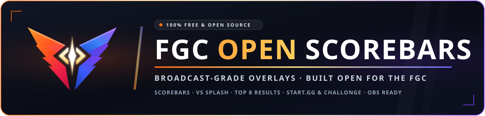

<p align="center">
  
</p>

# FGC Open Scorebars — Broadcast Suite for the FGC

[](LICENSE)
[](https://nodejs.org/)
[](https://obsproject.com/)
[](#tournament-integration-startgg--challonge)
[](#key-highlights)
[](https://ko-fi.com/nordi5ke)

A **100% free, open-source, zero-dependency** local OBS broadcast suite crafted for the Fighting Game Community (FGC) — supporting **Tekken 8**, **Street Fighter 6**, **Super Smash Bros. Ultimate** (Singles & Doubles 2v2), **2XKO**, **Fatal Fury: City of the Wolves**, **Avatar Legends**, **Mortal Kombat 1**, and **240+ fighting game character packs**.

Built on pure HTML/CSS/JS and a lightweight native Node.js HTTP/SSE server (~15–45 MB RAM, `<5 ms` latency) — **no cloud accounts, no paywalls, no subscriptions, no Electron bloat, and no `npm install` required**.

<p align="center">
  
</p>

---

## Visual Showcase & Live Demos

### 1. Live Broadcast Scorebars (HUD-Calibrated Across 6+ FGC Games)

<p align="center">
  
</p>

| Tekken 8 Native HUD (0 px Overlap) | TWT 2026 Blade · Flag Fade Studio |
| :---: | :---: |
|  |  |
| **SF6 Native Drive HUD** | **SF6 Broadcast White Studio** |
|  |  |

### 2. Interactive Full-Screen VS Splash & Matchups 2×2 Board (48+ Designs · 240+ Game Packs)

<p align="center">
  
</p>

| Mishima EWGF (Animated Vertical Divider) | Tekken 8 Clash | Arcade Pop |
| :---: | :---: | :---: |
|  |  |  |

### 3. Tournament Top 8 / Top 12 Results, Vector Card Shapes & Live Brackets (`16:9` & `4:5` PNG Export)

<p align="center">
  
</p>

| Champion Left Top 8 (`EVO Gold`) | Grand Top 3 Podium | Champion Spotlight + 8-Row Ladder |
| :---: | :---: | :---: |
|  |  |  |

---

## Key Highlights

- **Multi-Game HUD-Calibrated Scorebars (`index.html`, `sf6-themes.js`, `game-presets.js`):**
  - **87 built-in designs across 7 games:** **Tekken 8** (33 designs, including **🥊 PBRD Kazuya Fists** framing all 3 in-game round orbs), **Street Fighter 6** (24 designs with verified clearance around Drive Gauges, Control Type badges & Round Diamonds), **Super Smash Bros. Ultimate** (10 designs — Major, Pill Compact, Apex Slant, Kagaribi Light & Aurora Glass in Singles 1v1 and Doubles 2v2, Stock Icons, Stage icon, Seed & Pronouns), **2XKO** (7 designs — 1v1/2v2 Duo + 2 Champions + Fuse icons), **Avatar Legends** (5 designs — Native Filigree Scroll & elemental styles), **Mortal Kombat 1** (5 designs — Native HUD, Klassic Arcade, Chaosrealm, Lin Kuei & Shirai Ryu), and **Fatal Fury: City of the Wolves** (2 designs — safe clock/diamond clearance + Arcade/Smart control style).
- **VS Match Splash & Matchups 2×2 Board (`vs.html` & `vs-designs.js`):**
  - Full-screen **1v1 VS / "Up Next"** studio + **Top 8 Matchups 2×2** board (Winners + Losers synced straight from your bracket or manually customized per player, global & individual X/Y/Zoom drag framing, auto random fighter fill, **240+ fighting game character packs** via `StreamHelperAssets`, and **1920×1080 PNG export**).
- **Unified Top 8 / Top 12 Results + Vector Card Shapes & Border FX (`results.html`, `results-designs.js`, `res-card-engine.js`):**
  - **32 broadcast designs** across **12 layouts** (`16:9` horizontal & `4:5` vertical `1080×1350`, Top 8 & Top 12 / 9th, secondary/pocket characters, seeds, direct portrait drag/wheel framing, and pixel-perfect **1:1 WYSIWYG PNG export**).
  - **Precision SVG Vector Card Engine (`res-card-engine.js`):** 12 broadcast card shapes (**Global** AND **Individual Per-Player** 1st–12th), 8 continuous contour border styles (Solid, Double Frame, HUD Corner Brackets, Dashed, Metallic Gradient, Neon Core, Heavy Rails, Borderless), 6 border FX (Halo, Neon Pulse, Shimmer, Animated Energy Trace), adjustable border width, bevel cut size, custom color, and mathematical safe insets so badges and names never clip.
- **Dedicated Live Brackets & Pools Overlay (`brackets.html`, `brackets-designs.js`, `brackets-engine.js`, `top8-engine.js`):**
  - **Top 8 Double Elimination** (with automatic/manual **Grand Final Reset**), **Pools / Groups Progress**, **Single Pool Bracket Tree**, and **Top 16 Standings Table** — live-synced with Start.gg & Challonge plus non-destructive manual slot overrides.
- **OBS-Safe Broadcast Audio & Custom SFX System (`audio-engine.js`, `sfx-manager.mjs`, `audio.html`, `panel-audio.js`):**
  - **16 built-in offline Web Audio FGC SFX**, persistent custom **`.mp3` / `.wav` / `.ogg` / `.m4a` / `.webm`** uploads (magic-byte validated, HTTP `206` byte-range streamed), 8 auto-detected live broadcast events (Point Scored, Match Point, Victory, Round Change, VS Splash, Top 8 Reveal, etc.), Per-Preset packs, Per-Player signature sounds, Soundboard, preview auto-mute, strict monotonic deduplication, and 3 OBS audio routing modes (`per-overlay`, `scorebar-hub`, or single-mixer **`/audio.html` Dedicated Audio Hub**).
- **World & Regional Flag System On-Demand (`flags-manager.mjs`, `flags.js`, `flags-world-index.json`):**
  - **252 World Countries + 3,148 Regional / State / Province / Prefecture flags** across all 7 continents — filterable by continent, country, or region, downloaded on-demand or in 1-click offline packs cached locally in `data/flags/` (zero CORS taint in OBS & PNG export).
- **Native Start.gg (GraphQL v4) & Challonge (API v1) Integration + Seeding (`tournaments.mjs`):**
  - Strictly isolated multi-provider state (connecting Start.gg, Challonge, and Demo never overwrites another provider's data), 1-click **Clear Tournament**, full **Seeding & Phases** (`initialSeedNum` & phase seeds), Stream Queue, entrant/avatar import, side-swap-aware result reporting, **Match History & H2H**, and a **64-entrant multi-game Offline Demo Tournament**.
- **Universal "My Presets & Tournament Packs" (`panel-presets.js`) + Factory-Default Preset Switching:**
  - Save individual presets or full multi-module Tournament Broadcast Packs (Scorebar + VS Splash + Brackets + Results), and switch between built-in designs with clean factory-default resets (zero leftover overrides from previous presets, preserving all live match/player data).
- **Global Custom PC Fonts (`custom-fonts.js`) & Clickable Local Server / Live Sessions Monitor (`panel-sessions.js`):**
  - Upload `.ttf`/`.otf`/`.woff`/`.woff2` or use installed PC fonts globally across all overlays.
  - Click **`● Local Server OK · X overlay(s)`** in the header anytime to inspect live server health, active OBS/browser/LAN SSE sessions, disconnect stale sessions, and see session limits (`64` server cap + explanation of browser HTTP/1.1 6-tab leader sharing vs OBS CEF).
- **Security-First & Data-Safe Architecture:**
  - Atomic `state.json` persistence with automatic `.bak` crash recovery & non-destructive schema migration (`v1 → v2`), strict path-traversal & `.mjs`/dotfile static blocks, SSRF redirect validation, magic-byte validation on image/font/audio uploads, SVG script sanitization + CSP sandbox headers, RAM-only API tokens by default, and a **1-Click Data-Safe GitHub Auto-Updater**.

---

## Quick Start

> **Clean fresh install out of the box:** this repository contains **no preloaded API tokens, no personal players, and no match history**. On first launch, `server.mjs` automatically creates a fresh local `data/` directory on your machine (gitignored).

### Requirements
- **Node.js 18+** (recommended Node.js 20 / 22 / 24 LTS). **Zero npm packages required.**

### Windows (1-Click Launch)
1. Double-click **`Start_Scorebar.bat`**.
   - If Node.js is not installed on the PC, the launcher automatically offers to run **`Install_NodeJS.bat`** (uses `winget` with an automatic direct MSI fallback from `nodejs.org`).
2. Your browser opens the Control Panel at `http://localhost:8787/panel.html`.
3. Keep the terminal window open during your broadcast.

### macOS / Linux / Terminal
```bash
node app/server/server.mjs
```
- **Scorebar Overlay (OBS Browser Source):** `http://localhost:8787/`
- **VS Match Splash / Matchups 2×2 (OBS Browser Source):** `http://localhost:8787/vs.html`
- **Brackets & Pools Overlay (OBS Browser Source):** `http://localhost:8787/brackets`
- **Top 8 / Top 12 Results Overlay (OBS Browser Source):** `http://localhost:8787/results.html`
- **Dedicated Audio & SFX Hub (Optional Single OBS Mixer Channel):** `http://localhost:8787/audio.html`
- **Control Panel & OBS Custom Dock:** `http://localhost:8787/panel.html`

> Customize the port with `PORT=9090 node app/server/server.mjs`.

---

## OBS Studio Setup

### 1. Add Overlays (`Browser Source`)
1. In OBS Studio, add a **Browser** source for each overlay you need (`/`, `/vs.html`, `/brackets`, `/results.html`, and optionally `/audio.html`).
2. Set **Width** to `1920` and **Height** to `1080` (or `1080 × 1350` for `4:5` vertical Results).
3. Leave **Custom CSS** empty.
4. **Recommended for zero-flicker scene transitions & audio:**
   - Uncheck *"Refresh browser when scene becomes active"*.
   - Set **Page permissions** to *"Read access to OBS status information"*.
   - Check *"Control audio via OBS"* if using live SFX in that source (or route all SFX cleanly through a single `/audio.html` Browser Source).

### 2. Optional: Dock the Control Panel Inside OBS
1. In OBS Studio, go to **Docks → Custom Browser Docks…**
2. Name it `FGC Scorebar` and set the URL to `http://localhost:8787/panel.html`.
3. The panel automatically adapts to narrow dock widths (`<= 1320px`).

---

## Tournament Integration (Start.gg & Challonge)

All API tokens stay **strictly local** (RAM-only by default, with optional local persistence in gitignored `data/integrations.json`) and are never displayed back in the UI so they cannot leak on stream. Start.gg, Challonge, and Demo snapshots stay strictly isolated so loading two providers never clobbers each other.

### Start.gg
1. Generate a free Personal Access Token at [start.gg/admin/profile/developer](https://start.gg/admin/profile/developer).
2. Open the **Tournaments** tab, paste your tournament or event URL/slug and token, and click **Connect**.
3. Load sets from **Stream Queue** or **Active / Open**, browse **Seeding & Phases**, sync **Top 8 Bracket / Pools / Final Results**, import entrants + flags, and report final scores back to the bracket (side-swap-aware).

### Challonge
1. Copy your free API key from [challonge.com/settings/developer](https://challonge.com/settings/developer).
2. Paste your tournament URL (`challonge.com/slug` or `subdomain.challonge.com/slug`) and API key, then click **Connect**.
3. Supports **Live Score Sync**, **Report Result**, **Top 8 Bracket**, and **Final Standings**.

### Offline 64-Entrant Multi-Game Demo Mode
Select **Demo Tournament (No Token)**, pick any fighting game configuration (Tekken 8, SSBU, SF6, 2XKO, Fatal Fury CotW, GGST, Avatar Legends, etc.), and click **Connect** to test Stream Queue, Seeding, Brackets, Matchups 2×2, Top 8 Results, and H2H completely offline.

---

## Keyboard Shortcuts

Available whenever the Control Panel window or OBS Dock has focus:

| Shortcut | Action |
| :--- | :--- |
| `Alt + 1` / `Alt + Shift + 1` | `+1` / `-1` Point for Player 1 |
| `Alt + 2` / `Alt + Shift + 2` | `+1` / `-1` Point for Player 2 |
| `Alt + S` | Swap Sides (`P1 ⇄ P2`, auto-adjusts active bracket reporting) |
| `Alt + R` | Reset Score to `0 - 0` |
| `Alt + H` | Smoothly Show / Hide Overlay |
| `Alt + E` | Replay Live Scene Entry Transition in OBS |

---

## Creator, Community & Optional Support

Created with love for the Fighting Game Community by **Nordi5ke** ([N5K-dev](https://github.com/N5K-dev)).

**FGC Open Scorebars is and will always remain 100% free & open-source** — zero paywalls, zero subscriptions, and zero locked features. If this tool helped power your local, weekly, major, or stream and you would like to leave an optional tip to support future updates, feel free to buy a coffee on Ko-fi!

[](https://x.com/Nordi5ke)
[](https://www.youtube.com/@nordi5ke)
[](https://www.twitch.tv/nordi5ke)
[](https://github.com/N5K-dev)
[-FF5E5B?style=for-the-badge&logo=ko-fi&logoColor=white)](https://ko-fi.com/nordi5ke)

---

## License

Released under the [MIT License](LICENSE). Free for personal streams, local weeklies, community majors, and custom forks.
